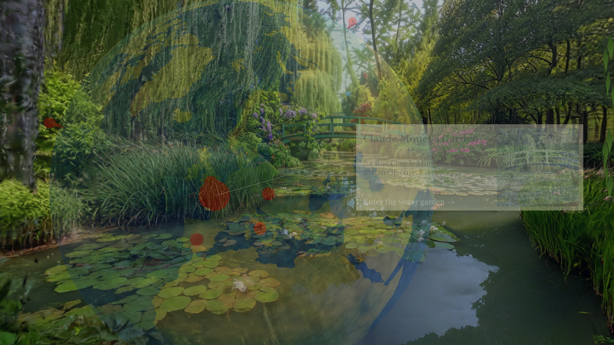
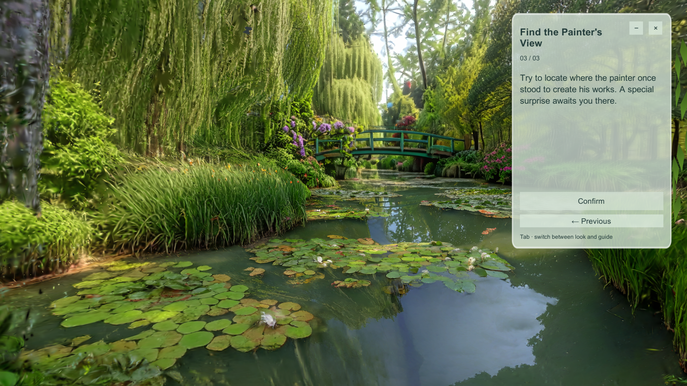
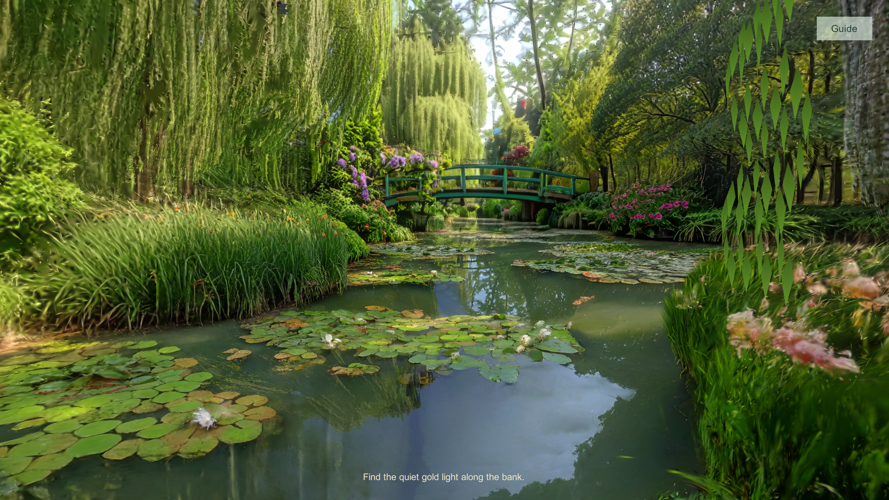
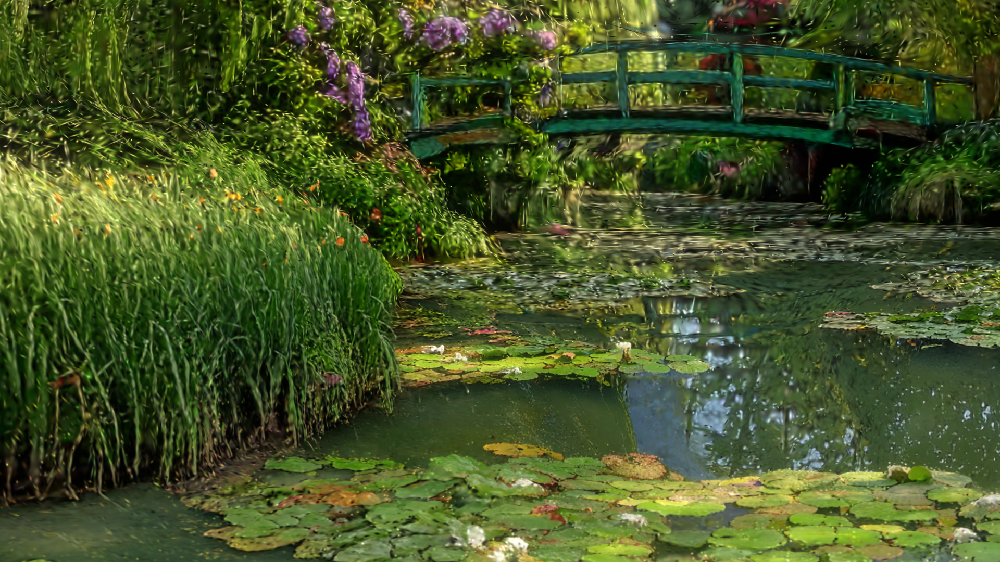
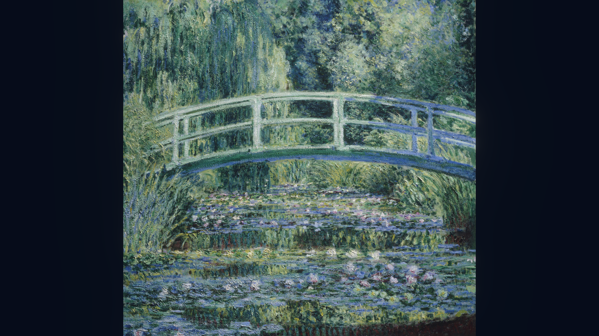
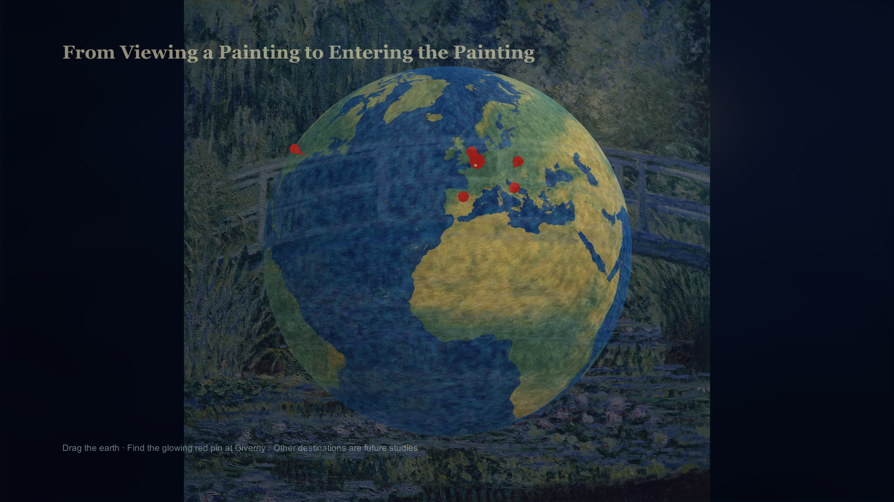
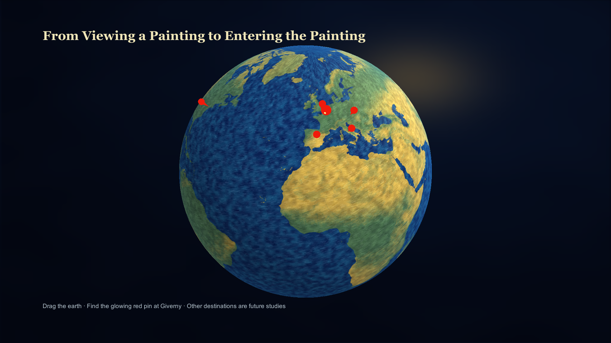

# 111 真实截图对应表

2026-10-25 本地111 Unity Play。全部1920×1080，无编辑器栏，无后期改画；顺序对应第二轮实际键鼠路线。动态转化为真实不同时刻，不代表额外操作步骤。

|截图/文件路径|阶段|玩家操作|实际反馈与功能|
|---|---|---|---|
|[01_Globe.png](Screenshots111/01_Globe.png)|地球入口|启动Play|实际帧呈现地球入口；UTC 2026-10-24T16:25:10.4298119Z|
|[02_GivernyCard.png](Screenshots111/02_GivernyCard.png)|吉维尼卡片|点击法国吉维尼红点|实际帧呈现吉维尼卡片；UTC 2026-10-24T16:29:03.5384998Z|
|[03_EnterGarden.png](Screenshots111/03_EnterGarden.png)|入园交叉淡入|点击地点卡片|实际帧呈现入园交叉淡入；UTC 2026-10-24T16:29:09.1100572Z|
|[04_GuideGarden.png](Screenshots111/04_GuideGarden.png)|花园介绍|进入后阅读/滚动|实际帧呈现花园介绍；UTC 2026-10-24T16:29:14.0475974Z|
|[05_GuideImpressionism.png](Screenshots111/05_GuideImpressionism.png)|印象派介绍|Continue|实际帧呈现印象派介绍；UTC 2026-10-24T16:29:24.8047348Z|
|[06_GuideQuest.png](Screenshots111/06_GuideQuest.png)|寻找观察点任务|Continue|实际帧呈现寻找观察点任务；UTC 2026-10-24T16:29:33.8001640Z|
|[07_Explore.png](Screenshots111/07_Explore.png)|探索起步|Confirm|实际帧呈现探索起步；UTC 2026-10-24T16:29:42.6690813Z|
|[08_ExploredBank.png](Screenshots111/08_ExploredBank.png)|沿岸探索|WASD/Shift移动|实际帧呈现沿岸探索；UTC 2026-10-24T16:29:56.8190188Z|
|[09_ObserveBridge.png](Screenshots111/09_ObserveBridge.png)|观察对齐|返回观察区面向桥，保持3秒|实际帧呈现观察对齐；UTC 2026-10-24T16:30:05.1389813Z|
|[10_TransitionStart.png](Screenshots111/10_TransitionStart.png)|转化起始|等待自动序列|实际帧呈现转化起始；UTC 2026-10-24T16:30:08.7893802Z|
|[11_PigmentScatter.png](Screenshots111/11_PigmentScatter.png)|颜料散开|等待|实际帧呈现颜料散开；UTC 2026-10-24T16:30:10.7863739Z|
|[12_PaintingAssembly.png](Screenshots111/12_PaintingAssembly.png)|画作重组|等待|实际帧呈现画作重组；UTC 2026-10-24T16:30:12.7896932Z|
|[13_PaintingReveal.png](Screenshots111/13_PaintingReveal.png)|原作显现|等待|实际帧呈现原作显现；UTC 2026-10-24T16:30:14.8066918Z|
|[14_OriginalPainting.png](Screenshots111/14_OriginalPainting.png)|完整原作|等待约10秒|实际帧呈现完整原作；UTC 2026-10-24T16:30:19.1280504Z|
|[15_ReturnCrossfade.png](Screenshots111/15_ReturnCrossfade.png)|返回交叉淡出|自动返回|实际帧呈现返回交叉淡出；UTC 2026-10-24T16:30:26.4745523Z|
|[16_GlobeAgain.png](Screenshots111/16_GlobeAgain.png)|地球再次可选|可再次选择地点|实际帧呈现地球再次可选；UTC 2026-10-24T16:30:31.5958964Z|

原始文件名、帧号、状态、进度和SHA256：[provenance.json](Screenshots111/provenance.json)。选图复制后与原帧逐字节一致。原作截图为游戏展示的原图，未用资源文件直接替代截图。

## 全部截图

### 地球入口

### 吉维尼卡片

### 入园交叉淡入

### 花园介绍

### 印象派介绍

### 寻找观察点任务

### 探索起步

### 沿岸探索

### 观察对齐

### 转化起始

### 颜料散开

### 画作重组

### 原作显现

### 完整原作

### 返回交叉淡出

### 地球再次可选

