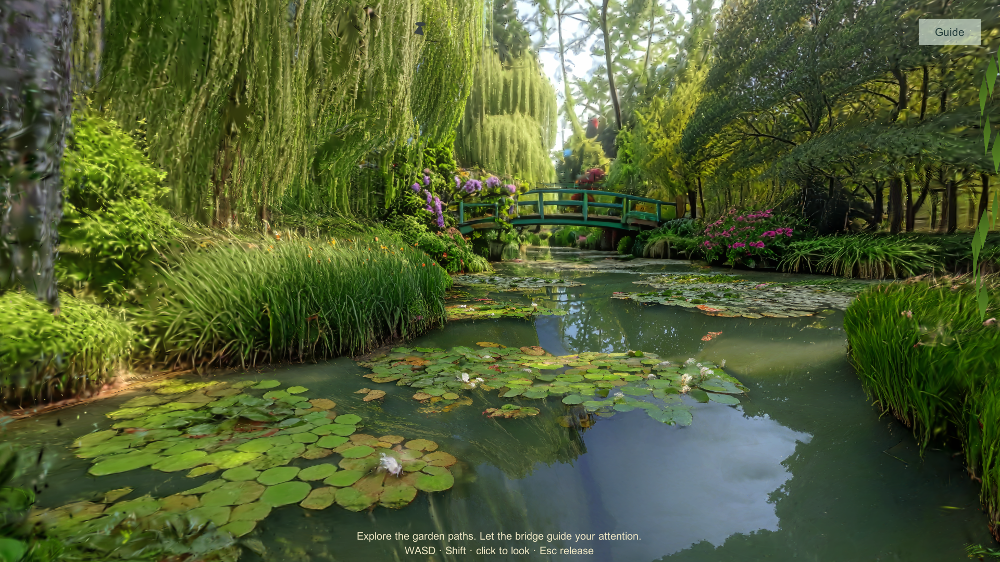
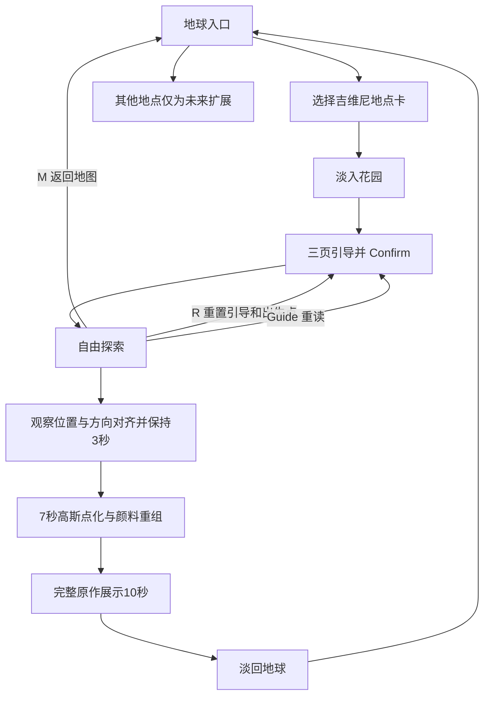
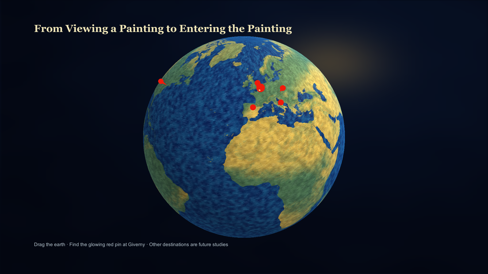
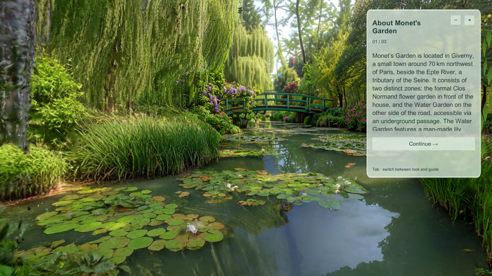
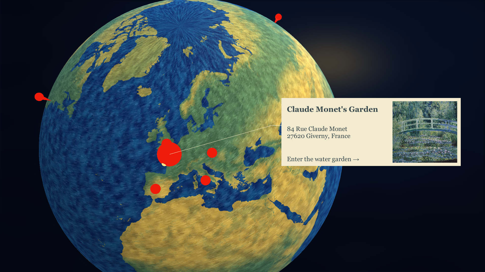
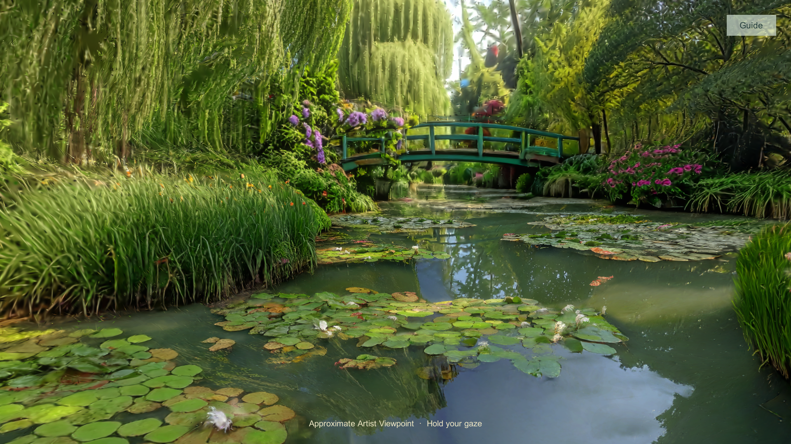
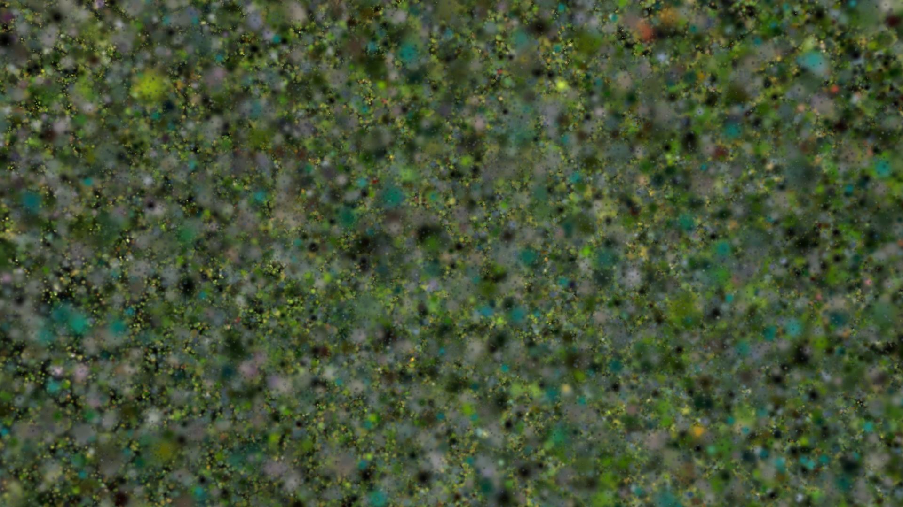
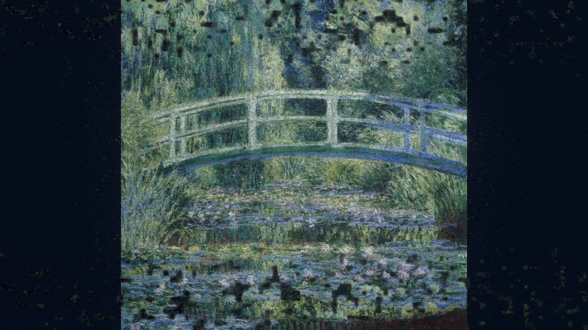
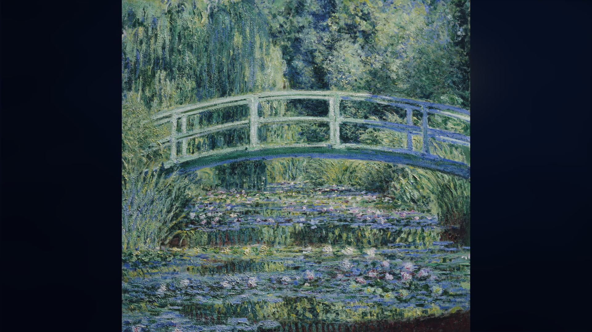

# 莫奈花园 · Monet Garden

基于 Unity 与 3D Gaussian Splatting 的花园交互体验，包含Windows键鼠版与独立PICO头显版：旋转地球选择吉维尼，阅读花园与印象派引导，进入花园探索，在近似画家观察点停留注视，观看花园转化为颜料与画作，再自动返回地球。

本页对应本地工程 **111**，于 **2026-10-25** 使用 Unity **2022.3.62f3c1** 实际运行、截图并重新构建。本仓库同时整理 **111 Windows键鼠版** 与独立的 **MonetGarden_PICO头显版**。作者已确认PICO适配和真机验证完成；本次另核对了PICO APK与已保存设备日志。[PICO说明与证据](PICO/README.md)。

## 下载与运行

在本仓库的 **Releases** 页面选择标注 **111 / 2026-10-25** 的 Windows 包，完整解压后运行 `MonetGardenVR.exe`。保留同目录的 `MonetGardenVR_Data`、`MonoBleedingEdge`、UnityPlayer.dll 等全部文件。程序窗口标题为 `111`。

原老师仓库的 `v0.1.0 / MonetGardenVR_Windows_Final.zip` 是历史构建，不能代表本页的新流程。新发布结果以 Release 实际附件为准。

本次测试环境为 Windows、RTX 4070 Laptop GPU、Direct3D 12。其他显卡未在本次Windows测试覆盖。PICO版另有设备事件证据，不将桌面显卡结果作为头显性能结论。

## PICO 头显版

从同一Releases下载 `MonetGarden_PICO4_FieldFix_20261011.apk`（0.1.2-fieldfix，ARM64）。独立工程在 [PICO/](PICO/README.md)，具有头部追踪、控制器射线与世界空间引导。左摇杆移动/入口旋转，右摇杆30°转向，扳机选择，A/X重新居中或开关引导。

作者已确认完成PICO适配与真机验证；保存日志记录了一次完整设备循环，原作停留10.0449秒。本次没有重新连接头显录屏，以下16张新截图全部属于Windows111。PICO版使用262144点移动端副本，不能把桌面画面直接当作头显画质。[完整状态](Documentation/PICO_READINESS.md)。

## Windows 完整体验顺序

1. 拖动地球，松开后有惯性减速。点击法国吉维尼发光红点，查看地点卡片。
2. 点击卡片进入水上花园，约 2.4 秒交叉淡入。
3. 阅读右侧三页引导：花园介绍、印象派、寻找观察点。第一页可滚动，按 Continue 翻页，第三页按 Confirm 确认任务。
4. 使用 WASD 沿岸边探索。任务确认后还需实际移动，再寻找岸边金色光点。近似观察点靠近起始区域。
5. 返回观察区域、面向日本桥并调整俯仰；出现 `Hold your gaze` 后保持位置和视角约 3 秒。无需额外按键触发。
6. 自动播放约 7 秒的场景点化、颜料散开和画作重组。期间镜头与移动锁定。
7. 完整原作按比例展示约 10 秒，随后约 2.4 秒淡回地球，可再次进入。

观察点是用于体验的近似构图位置，未经历史资料认证。作品使用工程提供的桥梁原图，具体作品名、年份与收藏机构尚未确认。

## 操作

| 输入 | 实际作用 |
|---|---|
| 地球上鼠标拖动 | 旋转地球，松开后惯性减速 |
| 点击吉维尼红点，再点击卡片 | 选择地点并进入花园 |
| Continue / Previous / Confirm | 引导翻页、返回、确认观察任务 |
| WASD / 左 Shift | 行走 / 加速（探索阶段） |
| 鼠标 | 捕获鼠标后调整视角 |
| Tab | 切换视角操作与 UI 交互；UI 模式会暂停移动和观察计时 |
| Esc | 释放鼠标并进入 UI 交互；用 Tab 恢复探索 |
| Guide / − / × | 重开 / 收起 / 关闭引导；关闭不能替代 Confirm |
| R | 探索时回到出生点，重新开始三页引导和探索任务 |
| M | 探索时返回地球 |
| G | 探索时切换附加动态环境层 |
| Alt+F4 | 关闭 Windows 程序 |

转化和原作展示期间，R / M / G 不作为跳过操作。没有发现多结局或额外可进入的目的地。

## 真实流程截图

所有正式截图来自本次 `111` 的 Unity Play 实际运行，1920×1080；没有生成、修饰或替换游戏画面。使用普通鼠标键盘完成路线，临时编辑器观察器仅记录画面和状态，没有移动玩家或改变时间。完整 16 张、操作说明和原始帧校验见 [截图对应表](Documentation/SCREENSHOT_INDEX_111.md)。

| 地球与卡片 | 引导与观察 |
|---|---|
|  |  |
|  |  |

| 转化中段 | 画作重组 |
|---|---|
|  |  |

## 工程查看与构建

源码使用 Git LFS 保存 PLY。克隆后执行 `git lfs pull`，避免导入文本指针。安装 Unity 2022.3.62f3c1 和 Windows Build Support，恢复有许可的 **3DGS-VFX 2.0.0** 依赖后，打开 `Assets/Scenes/MonetGarden_Prototype.unity`。其余 SampleScene 是示例，不是本次入口。

第三方插件源码因其许可限制未随公开仓库提供；直接下载 Windows 包即可体验。[依赖恢复说明](Documentation/DEPENDENCIES_111.md) 记录了插件和本项目 HLSL 的集成要求。源码不是零依赖开箱即用工程。

使用菜单 `Tools > Monet Garden > Build Windows Demo` 构建到工程内 `Builds/MonetGarden111/MonetGardenVR.exe`。发布副本的 Build Settings 已选中原型场景；原始 `111` 的默认 Build Settings 仍为 SampleScene，本次构建明确指定真实入口。

## 核对材料

- [版本差异与更新方案](Documentation/VERSION_COMPARISON_111.md)
- [本次运行测试记录](Documentation/VERIFICATION_2026-10-25.md)
- [截图对应表](Documentation/SCREENSHOT_INDEX_111.md)
- [依赖与源码限制](Documentation/DEPENDENCIES_111.md)
- [第三方资源声明](THIRD_PARTY_NOTICES.md)

旧交接文档、Validation、ProcessShots 和 ROUND2 报告保留为开发历史；其中历史通过数量、旧截图和日期不代表本次重新验证结果。以以上本次核对材料为准。
