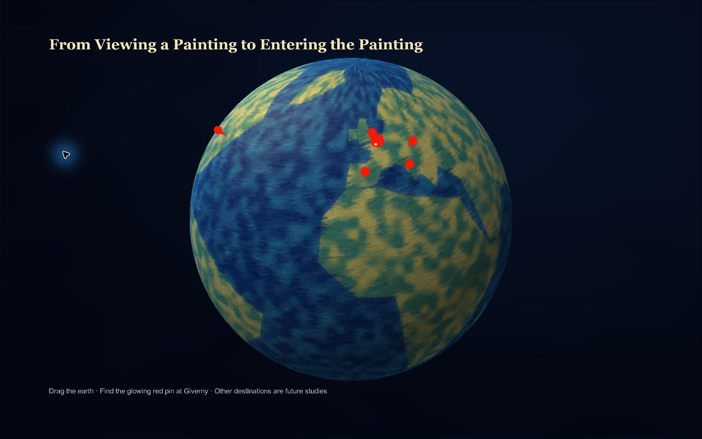

# 莫奈花园 · Monet Garden

基于 Unity 与 3D Gaussian Splatting 的莫奈花园桌面交互原型：旋转地球选择吉维尼，进入花园探索，在指定观察位置触发溶解、颜料重组与画作展示，随后返回地球。



## 直接运行

在 [Releases](https://github.com/xuxiaoyangzi/monet-garden-vr/releases) 下载 Windows ZIP，完整解压后运行 `MonetGardenVR.exe`。保留整个目录中的 Data、MonoBleedingEdge 和 DLL 文件。

拖拽地球 → 点击吉维尼标记 → 再次点击信息卡片进入花园。WASD 移动，Shift 加速；点击画面捕获鼠标，Esc 释放。回到出生区域附近光点，面对日本桥调整位置和视角，保持正确构图 3 秒后自动进入转化。画作展示 10 秒后自动返回地球。探索时 R 重置、M 返回地图、G 切换动态层；Alt+F4 退出。

## 打开源码

1. 安装 Git LFS，执行下列命令下载完整模型：

   ```sh
   git lfs install
   git clone https://github.com/xuxiaoyangzi/monet-garden-vr.git
   cd monet-garden-vr
   git lfs pull
   ```

2. 安装项目原版本 **Unity 2022.3.62f3c1**（中国版），并安装 Windows Build Support。其他版本兼容性未验证。
3. **先恢复外部插件**：本项目依赖 Dreamcore XR Labs 的 **3DGS-VFX 2.0.0**（`dreamcore.xr.3dgsvfx`）。其许可证限制源码再分发，因此本仓库不包含 `Assets/gsplat-unity-vfx/`。请从原作者合法取得同版本插件，连同原 `.meta` 文件恢复至该路径，保持 GUID，否则场景可能丢失引用或无法编译。原插件目录 GUID：`f9f884a8245d30f40b138b62ac1ca19d`。
4. 用 Unity Hub 添加仓库根目录，等待依赖导入。打开 `Assets/Scenes/MonetGarden_Prototype.unity` 后按 Play。默认 Build Settings 仍是原始 SampleScene，请使用专用构建菜单。
5. 构建：`Tools > Monet Garden > Build Windows Demo`，输出至 `Builds/MonetGardenFinal/MonetGardenVR.exe`。

**未安装外部插件时，源码不能直接运行。** 想直接体验请下载 Windows Release。

## 工程结构

| 路径 | 内容 |
| --- | --- |
| `Assets/Scenes/MonetGarden_Prototype.unity` | 演示入口 |
| `Assets/Scripts/MonetGarden/` | 花园体验、地球交互、视点与画作转化 |
| `Assets/Editor/MonetGarden/` | 构建、场景审计与 Play 验证菜单 |
| `Assets/MonetGarden/` | 材质、画作、地图、渲染及参考资源 |
| `Assets/models/`、`Assets/模型/` | Gaussian 模型，使用 Git LFS |
| `Packages/`、`ProjectSettings/` | Unity 依赖和项目配置 |
| `Documentation/` | 原始设计记录、操作指南、截图、历史验证与备份 |

## 文档与验证

- [详细操作指南](Documentation/DEMO_GUIDE.md)
- [最终设计说明](Documentation/FINAL_DESIGN_NOTES.md)
- [原始交付报告](Documentation/FINAL_REPORT.md)
- [PICO 状态](Documentation/PICO_READINESS.md)
- [整理记录](Documentation/REPOSITORY_NOTES.md)

已有编辑器验证入口：`Tools > Monet Garden > Audit Saved Scene` 和 `Run Play Validation`。仓库整理仅做文件一致性、依赖、敏感信息与 Git/LFS 检查，未重新执行 Unity 编译、Play 或构建。历史报告中的测试结果属于原始交付记录。

这是 Windows 桌面原型；PICO/头显交互尚未实现或验证。

## 资源与许可

公开可见不代表所有内容均采用开源许可。本次整理没有替作者添加统一 MIT 等许可。第三方插件继续遵守原作者许可；模型、参考画作、纹理等资源的授权范围应分别确认。参见 [第三方说明](THIRD_PARTY_NOTICES.md)。